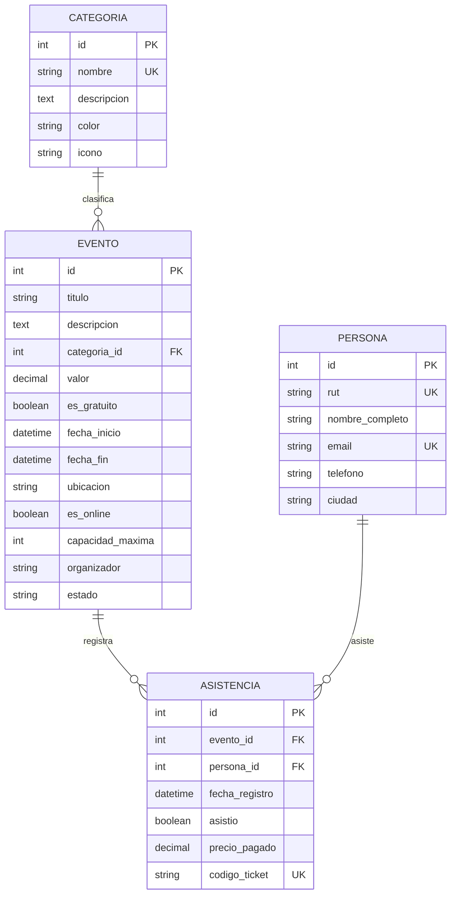

# Documentación: Aplicación de Eventos (`eventos`)

Aplicación Django desarrollada para la gestión, registro y analítica masiva de eventos temáticos, asistentes y registros de asistencia, optimizada para procesar grandes volúmenes de datos.

---

## 📌 Tabla de Contenidos

1. [Descripción General](#-descripción-general)
2. [Modelo de Datos](#-modelo-de-datos)
3. [Seeder Masivo (Big Data)](#-seeder-masivo-big-data)
4. [Vistas y Funcionalidades Web](#-vistas-y-funcionalidades-web)
5. [Panel de Administración (Django Admin)](#-panel-de-administración-django-admin)
6. [API REST / JSON](#-api-rest--json)
7. [Guía de Ejecución Rápida](#-guía-de-ejecución-rápida)
8. [Ejemplos de Consultas ORM](#-ejemplos-de-consultas-orm)
9. [Pruebas Automatizadas](#-pruebas-automatizadas)

---

## 🎯 Descripción General

La aplicación `eventos` permite:
- Gestionar un catálogo con **más de 500 eventos** organizados en 12 categorías temáticas.
- Diferenciar entre **eventos gratuitos (`Free`)** y **eventos de pago** con tarifas reales en pesos chilenos.
- Administrar una base de datos de **30.000 personas diferentes**, asegurando que **cada una de ellas posea asistencia comprobada** a los eventos.
- Consultar métricas en tiempo real: ocupación de aforo, ingresos por taquilla, distribución por categoría y perfiles de asistencia.

---

## 🗄 Modelo de Datos

La arquitectura de datos se compone de cuatro modelos interrelacionados:



### 1. `Categoria`
- `nombre`: Nombre único de la categoría temática (ej. *Tecnología & IA*, *Música & Conciertos*, *Gastronomía & Vinos*).
- `descripcion`: Descripción del alcance temática.
- `color`: Código hexadecimal distintivo para badges visuales (ej. `#6366f1`).
- `icono`: Clase de Bootstrap Icons asociada (ej. `bi-cpu`).

### 2. `Persona`
- `rut`: Rol Único Tributario chileno válido y con dígito verificador, único e indexado (`db_index=True`).
- `nombre_completo`: Nombre y dos apellidos del participante.
- `email`: Correo electrónico único e indexado.
- `telefono`: Teléfono de contacto en formato internacional (`+569########`).
- `ciudad`: Ciudad de residencia.

### 3. `Evento`
- `titulo`: Nombre descriptivo de la conferencia, festival, workshop o simposio.
- `categoria`: Relación `ForeignKey` hacia `Categoria` (`on_delete=models.PROTECT`).
- `valor`: Precio de la entrada general en pesos (`DecimalField`).
- `es_gratuito`: Booleano que indica si el evento es de libre acceso (`Free`).
  - *Regla de negocio*: Si `valor == 0`, `es_gratuito` se establece automáticamente en `True`.
  - La propiedad `@property def es_free` permite consultar rápidamente el estado sin costo.
- `fecha_inicio` y `fecha_fin`: Marcas temporales de ejecución del evento.
- `ubicacion`: Sede física (ej. *Espacio Riesco*, *Teatro Caupolicán*) o indicación de transmisión virtual.
- `es_online`: Booleano para eventos virtuales.
- `capacidad_maxima`: Aforo disponible (de 80 a 5.000 personas).
- `estado`: `programado`, `en_curso`, `finalizado` o `cancelado`.

### 4. `Asistencia`
- Vincula un `Evento` con una `Persona`.
- `UniqueConstraint(fields=['evento', 'persona'])`: Garantiza que una misma persona no se duplique dentro de un mismo evento.
- `asistio`: Booleano que confirma la asistencia efectiva del participante.
- `precio_pagado`: Importe abonado ($0 para eventos Free o el valor de lista para pagados).
- `codigo_ticket`: Código alfanumérico único para validación de entrada (`TK-XXXX-XXXXXX`).

---

## ⚡ Seeder Masivo (Big Data)

Para cumplir con el requerimiento de poblar **más de 500 eventos** y **30.000 personas diferentes que han asistido**, se construyó el comando de gestión optimizado:

```powershell
python manage.py seed_eventos
```

### Opciones disponibles

```powershell
# Reinicia y regenera toda la base de datos de eventos desde cero
python manage.py seed_eventos --reset

# Configura cantidades personalizadas
python manage.py seed_eventos --eventos 600 --personas 35000
```

### ¿Cómo logra ejecutarse en ~5 segundos?
Insertar 30.000 personas y 50.000 asistencias de forma individual con `Model.objects.create()` en SQLite requeriría varios minutos debido a la sobrecarga de I/O de disco por cada commit. Este seeder emplea:
1. **Generación en memoria vectorizada**: Nombres, RUTs matemáticamente válidos con algoritmo Módulo 11 y correos sintéticos únicos generados sin colisiones.
2. **`bulk_create` en lotes (`batch_size=3000`)**: Envía miles de registros en una única instrucción SQL `INSERT INTO`.
3. **`transaction.atomic()`**: Ejecuta cada fase dentro de una sola transacción ACID para máxima velocidad.
4. **Garantía del 100% de asistencia**: Se asigna a cada una de las 30.000 personas al menos un evento con `asistio=True`, y adicionalmente se generan ~20.000 asistencias complementarias para participantes recurrentes (totalizando ~50.000 asistencias).

### Resultados típicos del seeder:
```text
============================================================
[OK] SEEDER COMPLETADO CON EXITO
============================================================
- Total Eventos creados: 520 (Requerido: > 500)
  * Eventos Gratuitos (Free): 249
  * Eventos de Pago: 271
- Total Personas creadas: 30000
- Personas diferentes con asistencia comprobada: 30000 (Requerido: 30,000)
- Total registros de Asistencia: 49960
- Tiempo total de ejecucion: 5.20 segundos
============================================================
```

---

## 🌐 Índice de eventos

La única ruta del módulo es `GET /eventos/`. El índice devuelve todos los
registros de `Evento` como una lista JSON, equivalente a
`SELECT * FROM eventos_evento`. No aplica filtros ni límite:

```python
Evento.objects.values()
```

Si no hay eventos, la respuesta es una lista vacía (`[]`).

## 🚀 Guía de Ejecución Rápida

Abre una terminal PowerShell en la raíz del proyecto:

1. **Activar el entorno virtual:**
   ```powershell
   .\venv\Scripts\Activate.ps1
   ```

2. **Aplicar las migraciones:**
   ```powershell
   python manage.py migrate
   ```

3. **Cargar los datos de prueba masivos:**
   ```powershell
   python manage.py seed_eventos --reset
   ```

4. **Iniciar el servidor de desarrollo:**
   ```powershell
   python manage.py runserver
   ```

5. **Abrir en el navegador:**
   - Plataforma web: [http://127.0.0.1:8000/eventos/](http://127.0.0.1:8000/eventos/)
   - Panel Django Admin: [http://127.0.0.1:8000/admin/](http://127.0.0.1:8000/admin/)

---

## 💻 Ejemplos de Consultas ORM

Puedes interactuar con los datos directamente desde el shell de Django:

```powershell
python manage.py shell
```

```python
from eventos.models import Evento, Persona, Asistencia, Categoria
from django.db.models import Count, Sum, Avg

# 1. Total de eventos gratuitos vs pagados
Evento.objects.filter(es_gratuito=True).count()   # 249
Evento.objects.filter(es_gratuito=False).count()  # 271

# 2. Verificar que 30.000 personas diferentes asistieron
Asistencia.objects.filter(asistio=True).values('persona').distinct().count() # 30000

# 3. Top 5 eventos con mayor número de asistentes
top_eventos = Evento.objects.annotate(
    total=Count('asistencias')
).order_by('-total')[:5]

for e in top_eventos:
    print(f"{e.titulo}: {e.total} asistentes ({'FREE' if e.es_free else f'${e.valor}'})")

# 4. Total de recaudación por categoría
recaudacion = Categoria.objects.annotate(
    ingresos=Sum('eventos__asistencias__precio_pagado')
).order_by('-ingresos')

for c in recaudacion:
    print(f"{c.nombre}: ${c.ingresos:,.0f}")
```

---

## 🧪 Pruebas Automatizadas

La aplicación cuenta con una suite completa de pruebas unitarias y de integración que validan los modelos, constraints de unicidad y respuestas HTTP:

```powershell
python manage.py test eventos
```

Salida esperada:
```text
Ran 9 tests in 0.12s
OK
```
