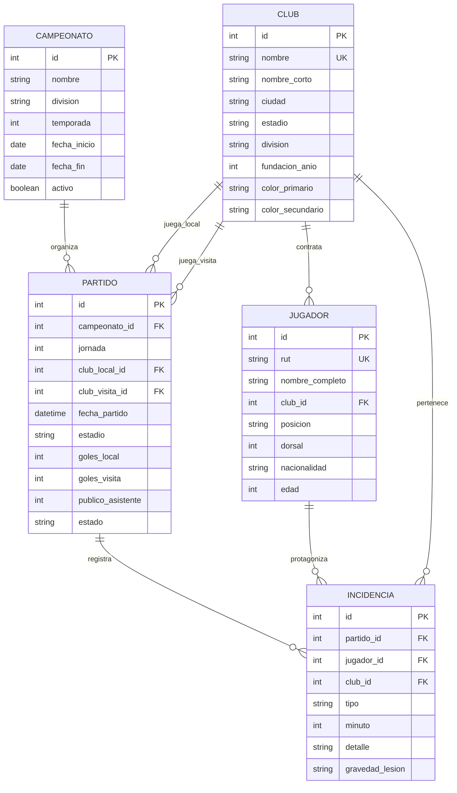

# Documentación: Aplicación de Fútbol Chileno & Campeonatos (`futbol`)

Aplicación Django desarrollada para la gestión, simulación y analítica de campeonatos de fútbol chileno (**Primera División** y **Primera B / Segunda División**), con registro detallado de resultados, goleadas, amonestaciones con tarjetas amarillas/rojas, reportes médicos de lesionados y consultas pedagógicas con el **ORM de Django**.

---

## 📌 Tabla de Contenidos

1. [Descripción General](#-descripción-general)
2. [Modelo de Datos](#-modelo-de-datos)
3. [Seeder y Simulación de Partidos](#-seeder-y-simulación-de-partidos)
4. [Módulo Pedagógico del ORM (Respuestas JSON)](#-módulo-pedagógico-del-orm-respuestas-json)
5. [Consultas Específicas del Campeonato](#-consultas-específicas-del-campeonato)
6. [Panel de Administración (Django Admin)](#-panel-de-administración-django-admin)
7. [Guía de Ejecución Rápida](#-guía-de-ejecución-rápida)
8. [Pruebas Automatizadas](#-pruebas-automatizadas)

---

## ⚽ Descripción General

La aplicación `futbol` permite:
- Administrar **32 clubes chilenos reales**, clasificados en:
  - **Primera División (16 clubes):** Colo-Colo, Universidad de Chile, Universidad Católica, Cobreloa, Everton, Coquimbo Unido, Palestino, Unión Española, O'Higgins, Audax Italiano, Huachipato, Ñublense, Deportes Iquique, Cobresal, Deportes Copiapó y Unión La Calera.
  - **Primera B / Segunda División (16 clubes):** Santiago Wanderers, Rangers de Talca, Deportes La Serena, Magallanes, Curicó Unido, San Luis de Quillota, San Marcos de Arica, Deportes Antofagasta, Deportes Temuco, Universidad de Concepción, Deportes Recoleta, Deportes Santa Cruz, Barnechea, Deportes Limache, Unión San Felipe y Santiago Morning.
- Gestionar **576 jugadores** divididos por posición (Arquero, Defensa, Mediocampista, Delantero) con dorsales, edades y RUT chileno.
- Simular **240 partidos oficiales** con marcadores reales y detección de **goleadas**.
- Registrar **incidencias minuto a minuto**:
  - Goles y tabla de goleadores.
  - Tarjetas amarillas y rojas (tribunal de disciplina).
  - Reporte de **lesiones** con diagnóstico médico y nivel de gravedad (leve, moderada o grave).

---

## 🗄 Modelo de Datos



---

## ⚡ Seeder y Simulación de Partidos

Para poblar y simular todo el torneo de fútbol chileno en ~1.5 segundos:

```powershell
python manage.py seed_futbol --reset
```

### Resultados típicos generados por el seeder:
```text
=================================================================
[OK] SEEDER DE FUTBOL COMPLETADO EXITOSAMENTE
=================================================================
- Total Clubes de Chile creados: 32 (16 Primera, 16 Primera B)
- Total Jugadores en planteles: 576
- Total Partidos simulados: 240
  * Partidos que fueron Goleadas: 89
- Total Goles anotados en los campeonatos: 694
- Total Tarjetas Amarillas mostradas: 860
- Total Tarjetas Rojas (Expulsiones): 40
- Total Jugadores Lesionados durante el torneo: 81
- Tiempo total de ejecucion: 1.58 segundos
=================================================================
```

---

## 🌐 Módulo Pedagógico del ORM (Respuestas JSON)

Siguiendo el estilo de la aplicación `eventos`, cada vista responde en formato **JSON estructurado** autodocumentado:

| Ruta | Nombre de URL | Operación SQL | Método ORM | Descripción |
| --- | --- | --- | --- | --- |
| `/futbol/` | `futbol:index` | Menú / Dashboard | Parámetro `?paso=` | Guía interactiva del taller y resumen general (`?paso=todos`). |
| `/futbol/select-all/` | `futbol:orm_select_all` | `SELECT *` | `.all()[:10]` | Consulta general de partidos con slicing pedagógico (`LIMIT 10`). |
| `/futbol/where/` | `futbol:orm_where` | `WHERE` | `.filter()` | Filtros específicos: amonestados, lesionados y clubes por división. |
| `/futbol/order-by/` | `futbol:orm_order_by` | `ORDER BY` | `.order_by()` | Ordenar partidos con más goles convertidos o partidos más recientes. |
| `/futbol/join/` | `futbol:orm_join` | `INNER JOIN` | `.select_related()` | Unión de partido con club local, visita e incidencias sin problema N+1. |
| `/futbol/agregaciones/` | `futbol:orm_agregaciones` | `COUNT`, `SUM`, `AVG` | `.aggregate()` | Métricas numéricas del campeonato (promedio de goles, asistencias de público). |

---

## 📊 Consultas Específicas del Campeonato

El sistema incluye endpoints para responder preguntas clave sobre el torneo:

### 1. ¿Quién se lesionó en el campeonato? (`/futbol/lesionados/`)
- **SQL Tradicional:**
  ```sql
  SELECT j.nombre_completo, c.nombre, i.detalle, i.gravedad_lesion, i.minuto
  FROM futbol_incidencia i
  JOIN futbol_jugador j ON i.jugador_id = j.id
  JOIN futbol_club c ON i.club_id = c.id
  WHERE i.tipo = 'lesion'
  ORDER BY i.id DESC;
  ```
- **Django ORM:**
  ```python
  lesionados = Incidencia.objects.filter(tipo='lesion').select_related('jugador', 'club', 'partido')
  ```
- **Respuesta JSON:** Diagnóstico médico, club, jugador y nivel de gravedad (leve, moderada o grave).

### 2. ¿Quién tuvo tarjeta amarilla o roja? (`/futbol/sancionados/`)
- **SQL Tradicional:**
  ```sql
  SELECT j.nombre_completo, COUNT(i.id) AS total_amarillas
  FROM futbol_jugador j
  JOIN futbol_incidencia i ON i.jugador_id = j.id
  WHERE i.tipo = 'tarjeta_amarilla'
  GROUP BY j.id ORDER BY total_amarillas DESC;
  ```
- **Django ORM:**
  ```python
  sancionados = Jugador.objects.annotate(
      total_amarillas=Count('incidencias', filter=Q(incidencias__tipo='tarjeta_amarilla'))
  ).filter(total_amarillas__gt=0).order_by('-total_amarillas')
  ```
- **Respuesta JSON:** Ranking de amonestados, riesgo de suspensión y lista de expulsados con tarjeta roja.

### 3. ¿Cuáles fueron las goleadas? (`/futbol/goleadas/`)
- **SQL Tradicional:**
  ```sql
  SELECT * FROM futbol_partido
  WHERE (goles_local + goles_visita) >= 4
     OR ABS(goles_local - goles_visita) >= 3
  ORDER BY (goles_local + goles_visita) DESC;
  ```
- **Django ORM:**
  ```python
  goleadas = Partido.objects.annotate(
      total_goles=F('goles_local') + F('goles_visita')
  ).filter(
      Q(total_goles__gte=4) |
      Q(goles_local__gte=F('goles_visita') + 3) |
      Q(goles_visita__gte=F('goles_local') + 3)
  ).order_by('-total_goles')
  ```
- **Respuesta JSON:** Lista de partidos que terminaron en goleada con sus incidencias.

### 4. Tabla de Posiciones Oficial (`/futbol/tabla-posiciones/?division=primera`)
- Calcula en tiempo real: Partidos Jugados (PJ), Ganados (PG), Empatados (PE), Perdidos (PP), Goles a Favor (GF), Goles en Contra (GC), Diferencia de Gol (DG) y Puntos (PTS).

### 5. Tabla de Goleadores (`/futbol/goleadores/`)
- Ranking de artilleros con goles anotados ordenados de mayor a menor.

---

## 🛡 Panel de Administración (Django Admin)

Modelos registrados en [`futbol/admin.py`](./futbol/admin.py):
- **`ClubAdmin`**: Filtros por división, ciudad, insignia visual con los colores del club y contador dinámico de jugadores en el plantel.
- **`JugadorAdmin`**: Búsqueda por nombre y RUT, filtros por posición y club, badges con estadísticas individuales (⚽ goles, 🟨 amarillas, 🚑 lesiones).
- **`PartidoAdmin`**: Jerarquía de navegación por fecha, badge indicador de `🔥 GOLEADA` y visor de resultado.
- **`IncidenciaAdmin`**: Badges diferenciados por tipo (`Gol`, `Tarjeta Amarilla`, `Tarjeta Roja`, `Lesión`).

---

## 🚀 Guía de Ejecución Rápida

1. **Aplicar migraciones:**
   ```powershell
   python manage.py migrate
   ```

2. **Ejecutar el seeder del campeonato:**
   ```powershell
   python manage.py seed_futbol --reset
   ```

3. **Iniciar el servidor de desarrollo:**
   ```powershell
   python manage.py runserver
   ```

4. **Acceder a las rutas:**
   - Menú interactivo: [http://127.0.0.1:8000/futbol/](http://127.0.0.1:8000/futbol/)
   - Reporte de lesionados: [http://127.0.0.1:8000/futbol/lesionados/](http://127.0.0.1:8000/futbol/lesionados/)
   - Tarjetas amarillas y rojas: [http://127.0.0.1:8000/futbol/sancionados/](http://127.0.0.1:8000/futbol/sancionados/)
   - Partidos con goleadas: [http://127.0.0.1:8000/futbol/goleadas/](http://127.0.0.1:8000/futbol/goleadas/)
   - Tabla de posiciones: [http://127.0.0.1:8000/futbol/tabla-posiciones/](http://127.0.0.1:8000/futbol/tabla-posiciones/)
   - Tabla de goleadores: [http://127.0.0.1:8000/futbol/goleadores/](http://127.0.0.1:8000/futbol/goleadores/)
   - Panel Django Admin: [http://127.0.0.1:8000/admin/futbol/](http://127.0.0.1:8000/admin/futbol/)

---

## 🧪 Pruebas Automatizadas

```powershell
python manage.py test futbol
```

Salida esperada:
```text
Ran 14 tests in 0.08s
OK
```
